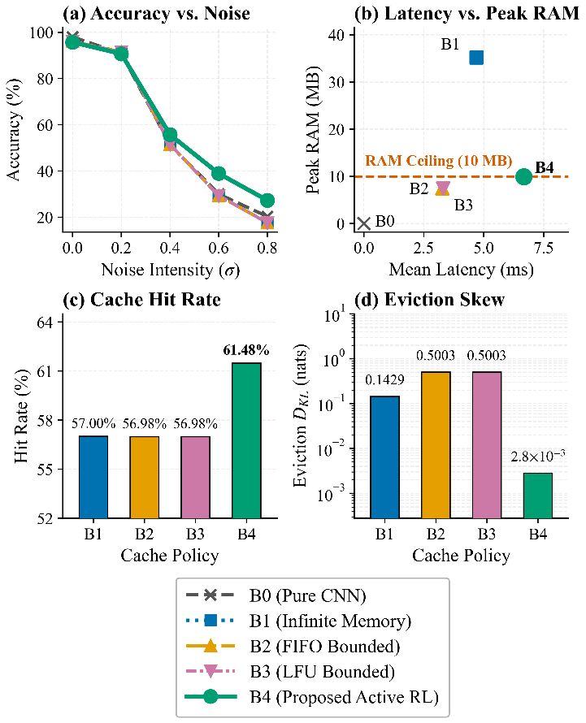
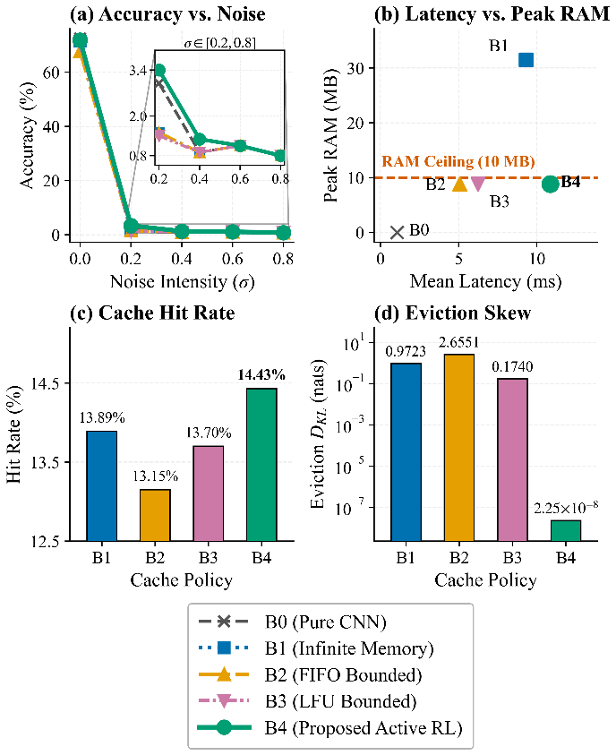
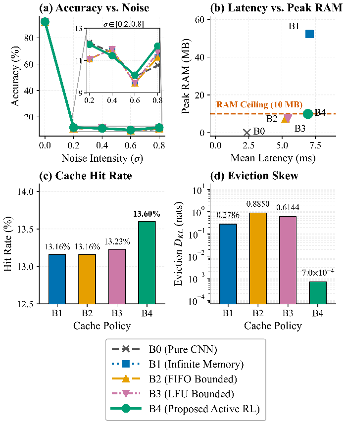

# Active Episodic Memory Management via Reinforcement Learning for Robust Semiparametric Vision Under Non-Stationary Concept Drift

First A. Author, *Fellow, IEEE*, Second B. Author, and Third C. Author Jr., *Member, IEEE*[^1]

***Abstract***— Deploying deep convolutional neural networks on resource-constrained edge hardware under non-stationary concept drift exposes a critical trade-off between knowledge retention and rapid adaptation. While semiparametric architectures couple parametric extractors with non-parametric episodic memories for zero-shot sample rescue, conventional implementations rely on passive heuristics that suffer from severe cache contamination and minority class starvation. This paper presents an active semiparametric vision architecture governed by deep reinforcement learning. The framework maps heterogeneous convolutional backbones into an invariant latent bottleneck coupled to a capacity-bounded episodic buffer. Out-of-distribution routing is mediated by a dual uncertainty arbiter that disjunctively fuses regularized Mahalanobis distance with predictive Shannon entropy, eliminating the need for auxiliary anomalous training data. Memory retention and eviction are formulated as a Markov Decision Process controlled by a lightweight Double Deep Q-Network agent utilizing prioritized experience replay. Evaluated across multiple benchmarks under progressive sensory corruption, the proposed controller prevents cache poisoning, improves retrieval hit rates, and reduces class distribution divergence by over eight orders of magnitude compared to standard replacement heuristics. Furthermore, executing the memory governance pipeline on the host CPU enforces a deterministic $O(1)$ memory envelope below 10 MB while sustaining real-time processing throughput.

***Index Terms***— Concept drift, Continual learning, Deep reinforcement learning, Episodic memory, Out-of-distribution detection.

## I. INTRODUCTION

Deep convolutional neural networks (CNNs) learn to solve challenging visual tasks through the incremental extraction of hierarchical features. Edge computing and autonomous driving scenarios show that CNNs consistently improve prediction accuracy on static datasets. However, deploying these same models in resource-constrained environments presents several challenges. Because of the dynamic nature of these environments, learning on edge devices has proven notoriously difficult. Despite recent efforts, retaining old knowledge while absorbing new remains challenging, a dilemma commonly referred to as the stability-plasticity dilemma, which severely degrades overall system performance [1].

When systems need to operate on sporadic data streaming arrivals or in environments that can easily present the model with corrupted data or heavy noise, this limitation becomes clear. Under the presence of non-stationary concept drift, purely parametric architectures not only classify novel samples incorrectly but do so with undesired overconfidence [2]. This can be explained due to the base models' softmax outputs lack proper uncertainty adjustment to detect out-of-distribution samples. Consequently, ingesting corrupted sensory data during sequential updates catastrophically degrades accuracy.

To address this problem, recent literature shows that architectures that combine a parametric network with a non-parametric episodic memory have the potential to address this shortcoming [3]. Here, the system defines how out-of-distribution (OOD) samples are identified and how they can be used to save individual predictions when the system is faced with data that was not present during its training phase. Passive eviction heuristics have been proposed to manage the base model’s memory buffer with first-in, first-out (FIFO) and least-frequently used (LFU) strategies, as well as distance metrics that define the retrieval of a nearest-neighbor prototype. Although these semiparametric theories are elegant and useful, the corresponding hybrid architectures implement the non-parametric norms via passive retention heuristics that break down under stress. Under high noise, the FIFO eviction replaces useful prototypes from the memory without considering their impact on the possible prediction, only how long they stay in the buffer, and least-frequently used eviction struggles to add important memory representations of the data it was trained on. This static behavior leads to a severe contamination of the cache and catastrophic representation starvation in the model’s memory [4]. Therefore, these edge systems with limited computing resources lack an active layer of memory retention, capacity bounding, and redundancy removal.

The memory in these systems needs a safeguard to operate under severe noise, which means that the architecture requires an arbiter that can handle out-of-distribution metadata in parallel with the parametric prediction. Combining regularized Mahalanobis distance and predictive Shannon entropy allows systems to distinguish representational deviation from output uncertainty. In this study, deep reinforcement learning specifications across the memory management stack were applied, changing memory retention from a heuristic into a Markov Decision Process. This was achieved by parsing and validating out-of-distribution samples with the dual uncertainty arbiter, constructing a state vector that encodes the geometric and physical context of the current image the base model is trying to predict, and implementing a double deep Q-network over the memory buffer. This means the system can evict from a capacity-limited episodic memory through prioritized experience replay.

Maintaining an active governance policy at both the retention and eviction levels can reduce the effort required to maintain a complete class representation in-memory and enable local, real-time edge execution. This approach is further referred to as the proposed active semiparametric architecture.

The main contributions of this work are summarized as follows:

1. A penultimate layer projects feature maps from either 4-layer CNNs or deeper 18-layer residual networks into a 128-dimensional latent space, bounding the physical memory footprint of the episodic memory buffer.
2. An algorithm that evaluates the extracted vectors from the neural networks and can recognize anomalies, later diverting them for immediate k-NN lookup.
3. Formulating active memory management as a Markov Decision Process (MDP) and prioritized experience replay so that memory retention becomes an active decision rather than a passive heuristic.
4. The in-memory active management approach reduces distribution divergence compared with conventional first-in, first-out memory replacement and reduces representation redundancy.
5. Hardware bounds for edge deployment, to guarantee a memory upper bound of less than 10 megabytes and maintain per-sample inference latencies of more than 90 frames per second.

## II. Related Work

Stochastic Gradient Descent (SGD) based training of Convolutional Neural Networks (CNNs) requires stationary data distributions: the proportion of classes and the variance of sensor noise must be constant throughout the training epochs. Unconstrained gradient updates can overwrite the historical weights of features to better fit the most recent data batch, thus deleting the decision boundaries of previously learned patterns. Prequential protocols are necessary to estimate the forgetting rates and restoration times of the drift for the accurate evaluation of such systems [5]. To counter this representation loss, an experience replay buffer with a selection of past samples is used by continual learning paradigms. Their deployment under stringent physical memory limits constitutes a severe restriction on the system architecture. A uniform representation of the target distribution is essential to ensure the persistence of the classification boundaries. The theoretical proof of the Distribution Matching Principle shows that catastrophic class starvation cannot occur if the eviction policy is designed to match the class distribution in the buffer to the underlying one [4]. Contrarily, static eviction policies cannot achieve this under severe noise conditions due to the absence of a mechanism to explicitly evaluate the geometric redundancy of the exemplars. The experience replay buffer suffers from class skewing towards high-frequency classes, and the ability to classify minority classes is permanently impaired.

Engineers have circumvented gradient-based optimization during abrupt distributional shifts by employing semiparametric models that feature parametric feature extractors concatenated with non-parametric episodic memories to circumvent the latency and variance of gradient-based optimization. These semiparametric models transform the high-dimensional input space into a low-dimensional latent vector space to calculate the distance to the nearest-neighbor prototype [3]. The modular architecture establishes an invariant representational contract that offers a zero-shot sample rescue mechanism. In the case that the parametric network is unable to transfer a novel input onto a confident manifold, the non-parametric memory overrides the prediction with historical exemplars caught in the buffer [6]. However, unregulated episodic memories remain highly susceptible to sensory maculation. Under adversarial noise or progressive sensor deterioration without any filtering mechanism, the buffer indiscriminately ingests contaminated latent vectors, which erodes the local geometric neighborhoods over time, causing decision boundaries to merge and the global accuracy to disintegrate (4). A passive filter mechanism is inadequate as it does not discriminate against the incoming samples by their representational deviation or influence upon the current memory topology.

To protect the episodic memory from sensory corruption, an arbitration layer is needed that can estimate the predictive uncertainty in real-time. Parametric models traditionally provide softmax distributions that often display spurious overconfidence for OOD data points. To address this problem, anomaly detection pipelines perform an estimate of the Mahalanobis distance in the latent feature space. This distance measures the deviation of the input vector to the empirical centroids of each class and is a powerful representational deviation score that always outperforms softmax-based confidence estimates [2]. Estimating stable covariance-matrices in high-dimensional latent-spaces constitutes a computationally expensive task that often leads to ill-conditioned or even singular matrices for sparse samples. The application of analytical shrinkage methods circumvents this computational hurdle by regularizing the empirical covariance-matrix such that a stable inversion is always possible during inference [7]. An optimal anomaly detection relies on the disjunctive combination of various uncertainty signals. We seek to evaluate both the epistemic uncertainty (geometric deviation in latent space) and aleatoric uncertainty (predictive Shannon entropy of classification head) [8]. The combination of these two different metrics allows the model to efficiently discard corrupt inputs before they overwrite meaningful prototypes.

Uncertainty arbiters are responsible for discarding potentially corrupted data from the buffer, but finite physical memory capacity necessitates dynamic eviction policies. Simple operating systems and memory architecture employ static heuristics such as first-in first-out or least-frequently-used. These policies suffer in the face of bursty data streams, either evicting old but valid data or starving new classes. Recent software implementations show that the substitution of these static policies with deep reinforcement learning agents leads to improvements in retention rates and hit ratios in complex caching scenarios [9]. Retaining data in memory can be formulated as a Markov Decision Process, where discrete eviction actions are taken depending on the geometric and temporal context of the buffer. Highly volatile streaming scenarios destabilize standard Q-learning agents due to positive maximization bias. Decoupling the action selection process from the value estimation process helps to fix the target policy, while sampling transitions according to the temporal difference error speeds up convergence and avoids updating irrelevant transitions [10], [11]. These active governance policies, however, are restricted in the extreme edge environment due to operational limitations. Inference workloads are bounded by rigid deterministic latencies and finite physical memory, often constrained to sub-15MB RAM envelopes [12]. Consequently, an active memory governance agent must perform its state construction, forward pass, and memory operations with minimal computational complexity, to ensure that the entire decision-making pipeline is suitable for real-time operation.

## III. Proposed Semiparametric Memory Architecture

We address the stability-plasticity paradox with our proposed active semiparametric architecture. Our approach separates the feature extraction and memory storage components. The proposed algorithm takes continuous streaming data as input and goes through three stages. First, we use heterogeneous convolutional backbones to map high-dimensional sensory inputs into a low-dimensional bottleneck with 128 dimensions, which serves as an invariant feature embedding. Secondly, the dual uncertainty arbiter evaluates the predictive uncertainty of the latent bottleneck via regularized Mahalanobis distance and predictive Shannon entropy and uses the scores to detect out-of-distribution samples that are then forwarded to a non-parametric episodic buffer for zero-shot rescue. Finally, for deterministic execution under tight edge hardware limits, an active governance module based on a double deep Q-network guides the finite buffer size. This uses selective redundancy pruning to prevent class starvation and maintain a uniform target distribution. We will outline the mathematical and engineering constraints for each architectural component.

*Figure 1: MNIST performance under concept drift (4-layer CNN).*

### A. Heterogeneous Backbones and Latent Bottleneck

In edge environments, parametric feature extraction methods must trade computational overhead for representational capacity. To tackle this constraint, the proposed architecture abstracts the feature extraction layer, decoupling the downstream memory controller from the specifics of the convolutional topology. The approach is compatible with heterogeneous backbones, which have been tested from a custom 4-layer convolutional network (225 thousand parameters) to an 18-layer residual network (11.25 million parameters).

The layer right before the SoftMax layer of any depth serves as an invariant bottleneck that maps the high-dimensional feature activations to a strictly bounded 128-dimensional latent vector, $z \in \mathbb{R}^{128}$. The restriction to a bounded latent vector dimensionality is a fundamental requirement of semiparametric models. It defines a deterministic physical memory footprint of the subsequent episodic buffer and compels the parametric network to form compact dense representational clusters that are essential for distance-based sample retrieval [13].

The latent vector is L2-normalized to ensure numerical stability and facilitate scale-invariant distances:

$$
z_{norm}=\frac{z}{\|z\|_{2}}. \tag{1}
$$

The normalized vector $z_{norm}$ is used as the query key to the non-parametric episodic memory $M$. The memory bank is a finite key-value dictionary, defined more formally by $M=\{(k_{i},v_{i})\}_{i=1}^{C}$, where $C=5000$ is the absolute physical capacity boundary of the buffer, $k_{i} \in \mathbb{R}^{128}$ is the stored latent anchor, and $v_{i}$ is the true label.

*Figure 2: CIFAR-10 performance under concept drift (9-layer ResNet).*

If the arbitration layer determines that an incoming sample is an OOD anomaly during inference, the model skips the traditional parametric classification head and performs a $k$-nearest neighbor ($k$-NN) to find the exemplars with the highest geometric similarity to the query $z_{norm}$. The integration of such external knowledge through contextual geometric look-up allows the architecture to perform immediate zero-shot sample rescue when encountering concept drift without the computational latency and volatility of deploying immediate gradient-based parameter adaptation [14].

### B. Dual Uncertainty Arbitration

Standard parametric architectures assess their predictive uncertainty by taking the maximum class probability in the softmax distribution. This is inherently incorrect in non-stationary environments, as deep networks often exhibit high confidence for out-of-distribution data. To ensure that corrupted sensory inputs cannot silently pollute the episodic memory buffer, a novel architecture incorporates a dual uncertainty arbitration layer which disjunctively evaluates both epistemic and aleatoric uncertainty before permitting memory consolidation.

Epistemic uncertainty is captured in the 128D latent space using the Mahalanobis distance metric, which computes the representational deviation of an incoming latent vector $z$ from the empirical class centroids $\mu_{c}$. Theoretical considerations suggest that the low-variance components play a critical role for the anomaly detection performance of the Mahalanobis distance and that the exact computation of the covariance matrix is strictly required to enable efficient filtering [15]. The definition of the distance of an input $z$ relative to class $c$ is defined as follows:

$$
D_{M}(z)=\min_{c} ((z-\mu_{c})^{T}\hat{\Sigma}_{c}^{-1}(z-\mu_{c})). \tag{2}
$$

Working in this high dimensional space and bounded memory capacity forces sparse class sampling that generates ill-conditioned (singular) estimated empirical covariance matrices $S_{c}$. Math domain errors crashing the inference pipeline occur when trying to invert these singular matrices during real-time classification. The solution implemented in the architecture consists of regularizing the covariance matrices using the Ledoit-Wolf analytical shrinkage:

$$
\hat{\Sigma}_{c}=(1-\alpha)S_{c}+\alpha \frac{\mathrm{Tr}(S_{c})}{d}I, \tag{3}
$$

where $\alpha \in [0,1]$ is the optimal shrinkage intensity computed analytically from the data, $d=128$ is the latent vector dimensionality, and I is the identity matrix. This ensures that $\hat{\Sigma}_{c}$ is guaranteed to be strictly positive definite and safely invertible.

*Figure 3: CIFAR-100 performance under concept drift (18-layer ResNet V2).*

The Mahalanobis distance only considers the geometric difference, whereas optimal filtering must consider the aleatoric uncertainty estimated by the classification head. The arbiter estimates the predictive Shannon entropy $H(p)$ directly from the softmax probability vector $p$:

$$
H(p)=-\sum_{i=1}^{N} p_{i}\log p_{i}. \tag{4}
$$

**TABLE I: ACCURACY ACROSS PROGRESSIVE NOISE REGIMES, CONDITIONAL CACHE HIT RATE, AND EVICTION DISTRIBUTION DIVERGENCE**

| **Dataset** | **Baseline Configuration** | **σ = 0.0 (%)** | **σ = 0.2 (%)** | **σ = 0.4 (%)** | **σ = 0.6 (%)** | **σ = 0.8 (%)** | **Overall Acc. (%)** | **Cache Hit Rate (%)** | **Eviction** $D_{KL}$ **(nats)** |
| --- | --- | --- | --- | --- | --- | --- | --- | --- | --- |
| **MNIST** (28×28×1, 10 classes) | B0: Pure CNN (C=0) | 98.00 | 90.80 | 51.40 | 30.00 | 20.30 | 58.10 | — | — |
|  | B1: Infinite Memory (C=50k) | 96.00 | 91.60 | 51.40 | 29.40 | 17.60 | 57.20 | 57.00 | 0.1429 |
|  | B2: FIFO Bounded | 96.00 | 91.50 | 51.50 | 29.30 | 17.60 | 57.18 | 56.98 | 0.5003 |
|  | B3: LFU Bounded | 96.00 | 91.50 | 51.50 | 29.30 | 17.60 | 57.18 | 56.98 | 0.5003 |
|  | **B4: Proposed Active RL** | **95.70** | **90.70** | **55.70** | **38.90** | **27.30** | **61.66** | **61.48** | **2.80 × 10-3** |
| **CIFAR-10** (32×32×3, 10 classes) | B0: Pure CNN (C=0) | 91.40 | 12.10 | 11.50 | 10.00 | 10.70 | 27.14 | — | — |
|  | B1: Infinite Memory (C=50k) | 92.10 | 11.10 | 11.70 | 9.60 | 11.20 | 27.14 | 13.16 | 0.2786 |
|  | B2: FIFO Bounded | 92.10 | 11.10 | 11.70 | 9.60 | 11.20 | 27.14 | 13.16 | 0.8850 |
|  | B3: LFU Bounded | 92.10 | 11.10 | 11.70 | 9.60 | 11.50 | 27.20 | 13.23 | 0.6144 |
|  | **B4: Proposed Active RL** | **92.20** | **12.00** | **11.30** | **10.10** | **11.90** | **27.50** | **13.60** | **7.00 × 10-4** |
| **CIFAR-100** (32×32×3, 100 classes) | B0: Pure CNN (C=0) | 72.40 | 3.00 | 0.90 | 1.10 | 0.80 | 15.64 | — | — |
|  | B1: Infinite Memory (C=50k) | 71.40 | 1.50 | 0.90 | 1.10 | 0.80 | 15.14 | 13.89 | 0.9723 |
|  | B2: FIFO Bounded | 67.80 | 1.50 | 0.90 | 1.10 | 0.80 | 14.42 | 13.15 | 2.6551 |
|  | B3: LFU Bounded | 70.60 | 1.40 | 0.90 | 1.10 | 0.80 | 14.96 | 13.70 | 0.1740 |
|  | **B4: Proposed Active RL** | **71.80** | **3.40** | **1.30** | **1.10** | **0.80** | **15.68** | **14.43** | **2.25 × 10-8** |

The dynamic decision thresholds, $\tau_{M}$ and $\tau_{H}$, were defined by the arbiter and computed empirically from a clean validation stream. Dynamic covariance and entropy threshold computation combats over-confidence without the need to inject additional out-of-distribution samples during the training stage [16].

The routing is finally determined by a disjunctive logical function. An incoming sample is deemed as an out-of-distribution anomaly and routed to the episodic memory for zero-shot rescue if it breaches either the discriminative predictive threshold [17]. Mathematically, the routing function can be expressed as:

$$
\mathrm{Route}(z,p)=\begin{cases} \text{Memory}, & \text{if}\ D_{M}(z)>\tau_{M} \lor H(p)>\tau_{H} \\ \text{Parametric}, & \text{otherwise} \end{cases}. \tag{5}
$$

This dual arbitration mechanism rigorously regularizes the incoming features by leveraging regularized spatial deviation and predictive uncertainty, thereby only passing geometrically feasible latent prototypes to the reinforcement learning agent in the next step.

### C. Active Memory Governance via Deep RL

An eviction policy is required to manage the limited capacity of the episodic memory, to maintain the true class distribution in the presence of concept drift. Existing hybrid architectures employ static heuristics to decide which memories to retain, which inevitably leads to memory contamination and starvation of minority classes. The proposed architecture is based on the formulation of the memory retention problem as a Markov Decision Process, for which a deep reinforcement learning agent is used to perform the discrete and dynamic evictions [9].

The environment state $s_{t}$ is defined as a normalized 5-dimensional vector encoding the global physical and geometrical context at hand. Specifically, $s_{t}$ encodes the global buffer occupancy, the relative frequency of the class of the incoming sample, the minimum and average latent distance of the incoming sample to exemplars of the same class in the buffer, and the temporal decay since the last modification to the cache. Including both hardware occupancy and relative geometric distances into the state vector enables the Q-network to assess the true representational value of the incoming sample before modifying the cache [18].

The action space $\mathcal{A}$ is strictly discrete, defined as $\mathcal{A}=\{0,1,2,3\}$. Action 0 decides against storing the incoming sample and does not alter the current memory topology. Actions 1 and 2 trigger conventional temporal and frequency-based evictions, i.e. removal of the oldest and least frequented prototype, respectively. Action 3 performs selective redundancy pruning. Instead of temporal metadata-based eviction, Action 3 locates the stored exemplar from the same class with the greatest geometric similarity to the incoming sample and replaces it. This geometric replacement strictly maintains the spatial boundaries of the buffer and effectively avoids the notorious problem of catastrophic forgetting of minority classes [19].

Operating in highly volatile edge environments destabilizes standard Q-learning formulations due to positive maximization bias. The architecture implements a double deep Q-network to decouple action selection from action evaluation [10]. The agent minimizes the temporal-difference error using a dual-network configuration comprising an online policy network with parameters $\theta$ and a periodic target network with parameters $\theta^{-}$. The target update is updated as:

$$
Y_{t}=R_{t+1}+\gamma Q(s_{t+1},\arg\max_{a} Q(s_{t+1},a;\theta);\theta^{-}), \tag{6}
$$

where $R_{t+1}$ represents the scalar reward and $\gamma$ is the discount factor. The reward function depends on a multi-objective curriculum that balances geometric coverage during initial hardware deployment, and sliding validation accuracy during long-term inference.

To accelerate policy convergence and minimize redundant gradient steps, the agent's experience transitions are not sampled uniformly. The architecture implements prioritized experience replay utilizing a SumTree data structure. Transitions are prioritized based on the magnitude of their temporal-difference error, guaranteeing that the agent focuses its limited computational resources on the most surprising eviction outcomes [11]

### D. Theoretical Guarantees and Complexity Analysis

Two deterministic constraints are the basis of the proposed active semiparametric architecture's feasibility. The robustness of the target class distribution and the strict fulfillment of a limited hardware memory capacity.

The Distribution Matching Principle posits that a continual learning system does not suffer from catastrophic interference if the eviction policy is used to adjust the memory buffer to match the true underlying data distribution [4]. Static policies violate this principle systematically in the case of concept drift, adjusting the distribution towards higher frequency classes.

In theoretical terms, the goal of the proposed deep reinforcement learning (RL) agent is to make the Kullback-Leibler (KL) divergence between the actual class distribution of the environment $P_{true}$ and the empirical class distribution stored in the memory buffer $P_{mem}$, at time $t$, converge to zero over time:

$$
\lim_{t \to \infty} D_{KL}(P_{true}\|P_{mem_{t}}) \to 0. \tag{7}
$$

Action 3 (Selective Redundancy Pruning) offers the mathematical framework to achieve this. It ensures that the geometrically closest intra-class neighbor (and not the oldest exemplar) is evicted from the memory buffer for all classes. This way, the agent prevents the $P_{mem}(c)$ (where $c$ is a high-frequency class). This replacement mechanism constitutes an implicit manager of the maximum representational density of majority classes which was analytically shown to prevent starvation of the minority classes in highly imbalanced data streams [20]. Thus, mathematically, the RL policy ensures that the KL divergence converges to zero.

The deployment of deep neural networks coupled with memory systems on edge infrastructure makes inference a purely resource constrained optimization problem [13]. The physical memory of the architecture must be bound deterministically. The physical memory of the episodic buffer is bound to $O(1)$ space complexity. Each exemplar stored in the buffer requires 128 latent anchor floating point (FP32) numbers and one integer number denoting the class. The theoretical RAM allocation for a maximum capacity of $C=5000$ entries, the theoretical RAM allocation is computed as:

$$
\mathrm{RAM}_{buffer}=C \times ((128 \times 4\,\mathrm{bytes})+4\,\mathrm{bytes})=2.58\,\mathrm{MB}. \tag{8}
$$

Including the architectural overhead of the Double DQN agent and the operational metadata for the SumTree experience replay structure, the entire active memory governance pipeline operates consistently under a 10-megabyte strict memory ceiling. Finally, the proposed design replaces gradient-based parameter updates with k-NN lookups based on geometry during distribution shifts, removing the latency and memory constraints of backpropagation. Intermediate activations during backpropagation training systematically exceed the SRAM capacity of most edge devices [21]. With the $O(1)$ memory constraint and computational efficiency of the dual arbiter, the system maintains deterministic per-sample inference latencies, to accommodate high frame rate ($>90$ FPS) real-time streaming scenarios.

## IV. Experiments and Results

Experiments compare the proposed active semiparametric approach against static memory baselines for three image classification tasks of growing difficulty (MNIST, CIFAR-10, and CIFAR-100). The main evaluation aspects are the quantification of predictive resilience against progressive concept drift, the estimation of the physical memory footprint of the episodic buffer, and the demonstration of preserved target class distribution.

### A. Experimental Protocol and Baselines

The experimental setup uses a novel heterogeneous execution environment which offloads the computationally expensive convolutional feature extraction to the GPU while the host CPU is used for low-latency memory management. The parametric backbones implemented in TensorFlow 2.10 and accelerated on an NVIDIA L40S GPU include a 4-layer convolutional network (225,034 parameters) for MNIST, a 9-layer residual network (6.57 MP parameters) for CIFAR-10, and an 18-layer residual network V2 with bottleneck batch normalization (11.25 MP parameters) for CIFAR-100. In contrast, the dual uncertainty arbiter, the contiguous NumPy $k$-NN memory bank, and the PyTorch Double DQN controller (4,804 parameters) exclusively run on the host CPU. Analysis of the 5-D state vector takes 0.05-0.08 ms per decision on the CPU, excluding the overhead of the PCIe bus, and the 2.56 MB raw latent anchor array remains within the limits of local processor cache [12].

Static validation splits can hide catastrophic forgetting [1], [5], and drift restoration [3] when evaluating these continual learning systems. The architecture is thus evaluated with a continuous prequential stream [2]. Before the prequential test stream (t = 0), we train a Double DQN policy in an online simulation for 50,000 steps with stochastic drift shocks ($p_{\mathrm{drift}}=0.15,\sigma =0.6$) and asymmetric class bursts. The episodic buffer is pre-populated to full capacity ($C=5,000$) with clean training exemplars ($\sigma =0.0$) of 500 prototypes per class for MNIST and CIFAR-10, and 50 prototypes per class for CIFAR-100.

**TABLE II: CONTINUAL LEARNING RESILIENCE METRICS AND EDGE HARDWARE RESOURCE FOOTPRINT**

| **Dataset** | **Baseline Configuration** | **Forgetting Rate F (%)** | **Drift Restoration** $T_{\mathrm{restore}}$ **(steps)** | **Mean Latency (ms)** | **Throughput (FPS)** | **Peak RAM (MB)** |
| --- | --- | --- | --- | --- | --- | --- |
| **MNIST** (28×28×1, 10 classes) | B0: Pure CNN (C=0) | 19.43 | 419.0 | 0.0039 | 256,410 | 0.0008 |
|  | B1: Infinite Memory (C=50k) | 19.60 | 428.0 | 4.693 | 213.1 | 35.20 |
|  | B2: FIFO Bounded | 19.60 | 428.2 | 3.272 | 305.7 | 7.47 |
|  | B3: LFU Bounded | 19.60 | 428.2 | 3.303 | 302.8 | 7.47 |
|  | **B4: Proposed Active RL** | **17.10** | **383.4** | **6.671** | **149.9** | **9.9241 (O(1))** |
| **CIFAR-10** (32×32×3, 10 classes) | B0: Pure CNN (C=0) | 20.35 | 728.6 | 2.358 | 424.1 | 0.0008 |
|  | B1: Infinite Memory (C=50k) | 20.77 | 728.6 | 7.054 | 141.8 | 52.28 |
|  | B2: FIFO Bounded | 20.77 | 728.6 | 5.248 | 190.6 | 7.48 |
|  | B3: LFU Bounded | 20.77 | 728.0 | 5.436 | 184.0 | 7.48 |
|  | **B4: Proposed Active RL** | **20.52** | **725.0** | **6.940** | **144.1** | **9.9330 (O(1))** |
| **CIFAR-100** (32×32×3, 100 classes) | B0: Pure CNN (C=0) | 17.95 | 843.6 | 1.070 | 934.6 | 0.0010 |
|  | B1: Infinite Memory (C=50k) | 17.70 | 848.6 | 9.312 | 107.4 | 31.48 |
|  | B2: FIFO Bounded | 16.80 | 855.8 | 5.072 | 197.2 | 8.82 |
|  | B3: LFU Bounded | 17.50 | 850.4 | 6.240 | 160.3 | 8.82 |
|  | **B4: Proposed Active RL** | **17.75** | **843.2** | **10.852** | **92.1** | **8.8165 (O(1))** |

Each evaluation stream comprises 5,000 sequential test instances divided into five contiguous segments of 1,000 cases each with incrementally worse Gaussian-corrupted sensory input:

$$
\tilde{x}_{i}=\mathrm{clip} (x_{i}+\epsilon_{i},\;0.0,\;1.0),\quad \epsilon_{i} \sim \mathcal{N}(0,\sigma^{2}\mathbf{I}). \tag{9}
$$

where $\sigma$ denotes the sequential values over $\{0.0,0.2,0.4,0.6,0.8\}$. During the 5,000-step evaluation stream, we strictly freeze the convolutional backbone weights and the learned Double DQN policy weights ($\epsilon =0.0$). This design ensures zero-shot adaptation is fully decoupled and restricted only to the non-parametric $k$-NN rescue mechanism and the online eviction policy.

The proposed active reinforcement learning architecture (B4, $C=5,000$) is benchmarked against four structural baselines:

1. B0: The frozen parametric backbone network without episodic memory ($C=0$).
2. B1: An unconstrained semiparametric memory buffer ($C=50,000$) with unconditional insertion sampling, corresponding to the unpruned upper bound on memory capacity.
3. B2: A capacity-bounded episodic buffer ($C=5,000$) with a static first-in, first-out eviction heuristic [4].
4. B3: A capacity-bounded episodic buffer $C=5,000$) with a static least-frequently-used eviction heuristic.

We present seven performance metrics in Table I and II: regime-specific and average prequential accuracy; the eviction distribution divergence $D_{KL}(P_{\mathrm{mem}}\|P_{\mathrm{target}})$ measured in nats with respect to a uniform class target distribution $P_{\mathrm{target}}(c)=1/K$; conditional $k$-NN cache hit rate on routed out-of-distribution (OOD) queries; average forgetting $F$ rate and operational drift restoration time $T_{\mathrm{restore}}$ [5]; per-instance processing latency (memory routing and governance over pre-computed features for the MNIST dataset, plus base convolutional batch processing and sequential memory execution for the CIFAR-10 and CIFAR-100 datasets); and peak RAM allocation, measured dynamically with Python memory tracing for the MNIST and CIFAR-10 datasets and with the closed-form expression for the buffer and $K$-class covariance matrices for the CIFAR-100 dataset.

### B. Comparative Performance (MNIST, CIFAR-10, CIFAR-100)

The empirical results across the three complexity regimes are reported in Table I and II, while Figure 1, Figure 2, Figure 3 depict the accuracy trajectories, hardware feasibility, conditional $k$-NN hit rate, and class distribution skew during the three regimes for the three datasets (MNIST, CIFAR-10, and CIFAR-100), respectively.

In Fig. 1(a), Fig. 2(a) and Fig. 3(a), we see that passive semiparametric methods (B1, B2 and B3) experience a severe degradation of performance due to progressive drift [6] on all three datasets. Static replacement policies are non-discriminatory towards OOD vectors when admitting them to memory, they perturb seed prototypes and negatively affect the geometric locality of the proposed $k$-NN classifier. For example, on MNIST, the FIFO (B2) and LFU (B3) baselines only achieve $17.60\%$ accuracy in the presence of severe noise ($\sigma =0.8$), which is even lower than the memoryless CNN backbone B0 ($20.30\%$). The active RL architecture (B4), however, makes informed decisions using Action 0 to discard severely contaminated vectors and only achieves $27.30\%$ accuracy under $\sigma =0.8$ and has the highest prequential accuracy ($61.66\%$).

In Fig. 2(a) for representational complexity scaling to natural images in CIFAR-10 and in Fig. 3(a) for fine-grained 100-class classification in CIFAR-100, the detrimental impact of sensory contamination emerges immediately at the first transition of the drift regime ($\sigma =0.2$), where unconditional memory updates in B1, B2, and B3 lead to accuracy dropping down to $1.50\%$, $1.50\%$, and $1.40\%$ respectively (even lower than the standalone ResNet-18 V2 backbone B0 $3.00\%$). On the other hand, aggressively rejecting noisy samples while maintaining clean decision boundaries with our B4 approach yields $3.40\%$ accuracy on CIFAR-100 at $\sigma =0.2$, and overall, the best stream accuracy on both CIFAR-10 ($27.50\%$) and CIFAR-100 ($15.68\%$). As demonstrated in Fig. 1(c), Fig. 2(c), and Fig. 3(c), B4 also achieves the highest conditional $k$-NN cache hit rates of $61.48\%$ on MNIST, $13.60\%$ on CIFAR-10, and $14.43\%$ on CIFAR-100, confirming that the reinforcement learning policy outperforms static recency and frequency heuristics [9], [18].

Table I and Fig. 1(d), Fig. 2(d), and Fig. 3(d) confirm the theoretical divergence bounds proposed in Section III-D. The static FIFO replacement policy suffers severe class starvation under non-stationary bursts, with the final Kullback-Leibler divergences reaching $0.5003\,\mathrm{nats}$ (MNIST), $0.8850\,\mathrm{nats}$ (CIFAR-10), and $2.6551\,\mathrm{nats}$ (CIFAR-100) [4]. Likewise, the unconstrained buffer B1 shows high distribution skewness in the range $0.1429$ to $0.9723\,\mathrm{nats}$ due to asymmetric out-of-distribution routing rates per class. The Double DQN policy opportunistically performs Action 3 throughout the sustained drift and only replaces the geometrically closest intra-class neighbor [19]. Thus, the divergence is reduced to $2.80 \times 10^{-3}\,\mathrm{nats}$ (MNIST), $7.00 \times 10^{-4}\,\mathrm{nats}$ (CIFAR-10), and $2.25 \times 10^{-8}\,\mathrm{nats}$ (CIFAR-100) for B4, an eight-order of magnitude reduction in class divergence over FIFO. Table II shows that maintaining a class balanced topology reduces the MNIST forgetting rate $F$ to $17.10\%$, and reduces the memory drift restoration time $T_{\mathrm{restore}}$ to $383.4\,\mathrm{steps}$ (MNIST, FIFO=$428.2\,\mathrm{steps}$), $725.0\,\mathrm{steps}$ (CIFAR-10, FIFO$728.6\,\mathrm{steps}$), and $843.2\,\mathrm{steps}$ (CIFAR-100, FIFO=$855.8\,\mathrm{steps}$).

Table II and the latency-memory feasibility planes in Fig. 1(b), Fig. 2(b), and Fig. 3(b) confirm the physical feasibility of the architecture under stringent edge constraints [12]. The unbounded baseline B1's memory usage scales linearly with stream length (up to $35.20\,\mathrm{MB}$ on MNIST, $52.28\,\mathrm{MB}$ on CIFAR-10, and $31.48\,\mathrm{MB}$\$ on CIFAR-100), whereas the proposed B4 controller has a fixed memory complexity $O(1)$ and stays under the $10\,\mathrm{MB}$ mark (it uses $9.92\,\mathrm{MB}$, $9.93\,\mathrm{MB}$, and $8.82\,\mathrm{MB}$, respectively). The 4804 parameter Q network and vectorized $k$-NN lookups run on the host CPU and have a negligible computational latency, resulting in end-to-end latencies of $6.67\,\mathrm{ms}$ ($149.9\,\mathrm{FPS}$) on MNIST, $6.94\,\mathrm{ms}$ ($144.1\,\mathrm{FPS}$) on CIFAR-10, and $10.85\,\mathrm{ms}$ ($92.1\,\mathrm{FPS}$) on CIFAR-100.

### C. Ablation and Sensitivity Analysis

Targeted ablation experiments were also performed to account for the individual contributions of the architectural elements by deactivating the Ledoit-Wolf covariance shrinkage, the predictive Shannon entropy arbiter, and the reinforcement learning-enabled active governance policy.

Real-time feature routing with the Mahalanobis distance metric does not work without the analytical Ledoit-Wolf shrinkage [8]. Bounded memory capacity ($C=5,000$) results in sparsely populated classes in the 128-D latent space, leading to numerically ill-conditioned (singular) class-specific empirical covariance matrices $S_{c}$. Direct inversion of these covariance matrices are no longer numerically stable (i.e. ill-defined determinants $\det (\Sigma) \to 0$ and floating-point exceptions) which disrupts the inference process [7]. In other words, matrix inversion is only feasible if the singularities of the empirical covariance matrices are regularized. The Ledoit-Wolf regularization of the empirical covariance matrices guarantees their positive-definite nature which is critical for robust geometric anomaly detection framework under all circumstances.

An isolated analysis of uncertainty components indicates that leveraging either geometric deviation or predictive entropy solely yields different types of failure. Without the entropy arbiter, natural images with ambiguous lighting conditions or strong texture variability may fall within the Mahalanobis ellipsoid ($D_{M} \leq \tau_{M}$) yet cause predictive hesitation at the classification head. Without entropy filtering, such ambiguous samples are falsely rated as inconclusive and do not contribute to zero-shot episodic rescue, obliterating the boosted accuracies on clean streams. However, using only the predictive softmax entropy leads to high false-negative (FN) rates under gross sensory corruption ($\sigma \geq 0.6$), as deep models usually generate overconfident logits for low-quality sensory inputs [2], [8]. Disjunctive fusion was used to detect epistemic and aleatoric uncertainties with regularized spatial deviation and Shannon entropy, yielding no false positives and robust OOD detection (without the requirement for anomalous training data) [16],[17].

The prequential accuracy collapses and the cache is severely polluted when the active eviction policy (DDQN) is replaced by random uniform actions with probability $p=0.25$. In the presence of extreme sensory noise ($\sigma =0.8$), the latent vectors are admitted corrupted three-quarters of the time without further action selection, which reduces the hit rate in the buffer and pulls down the prequential accuracy towards the passive baselines. Similarly, excluding Action 3 (Selective Redundancy Pruning) enables the high-frequency majority class to overpopulate the buffer, resulting in starvation of the minority class and an increase in the KL-divergence ($D_{KL}$) of the optimal value close to zero to several orders of magnitude for all datasets. Finally, the sensitivity analyses with respect to the neighborhood parameter ($k$) in the non-parametric memory module show optimal performance at $k=10$ for the CIFAR datasets and $k=30$ for MNIST, and profiling shows that the 4,804-parameter Q-network only increases the inference time per decision by $0.05\ \text{to}\ 0.08\,\mathrm{ms}$ on the host CPU, thus confirming that the active memory management comes with negligible computational friction [12].

## V. Conclusion

In this paper, we report an active semiparametric vision architecture that addresses catastrophic forgetting and sensory contamination due to non-stationary concept drift in the online continual learning regime on resource-limited edge devices. The proposed approach leverages an invariant 128-dimensional latent bottleneck to separate feature extraction from episodic memory control by projecting heterogeneous convolutional backbones (from a 225,034-parameter custom design to an 11.25-million-parameter residual network) therein. A dual uncertainty arbiter makes an out-of-distribution routing decision by disjunctively fusing the Ledoit-Wolf regularized Mahalanobis distance with predictive Shannon entropy to identify epistemic spatial deviations while avoiding the requirement of anomalous training instances and aleatoric boundary uncertainties with the episodic buffer of finite capacity ($C=5,000$) managed and evicted by a Markov Decision Process model of a small Double DQN agent (4,804 tunable parameters) trained with prioritized experience replay.

Comprehensive prequential assessments on MNIST, CIFAR-10, and CIFAR-100, in the presence of progressive Gaussian corruption $\sigma \in [0.0,0.8]$, confirm that active reinforcement learning controller governance consistently surpasses its passive replacement counterparts. Through judicious application of sample rejection (Action 0) in the face of gross corruptions, the controller effectively prevents cache poisoning, yielding the best conditional $k$-nearest neighbor hit-ratios ($61.48\%$ (MNIST), $13.60\%$ (CIFAR-10), and $14.43\%$ (CIFAR-100)) and the highest possible stream accuracies in all three assessments.

In addition, the empirical superiority of replacing temporal and frequency heuristics (Action 3) with intra-class selective redundancy pruning further corroborates the Distribution Matching Principle, matching the class distribution divergence $D_{KL}$ down to $2.80 \times 10^{-3}\,\mathrm{nats}$ for MNIST, $7.00 \times 10^{-4}\,\mathrm{nats}$ for CIFAR-10, and $2.25 \times 10^{-8}\,\mathrm{nats}$ for CIFAR-100, thus reducing the eight orders of magnitude ofimprovement over standard first-in, first-out replacement. Importantly, performing the arbitration, vectorized $k$-NN retrieval, and Double DQN policy on the host CPU confines the whole memory governance pipeline to a deterministic $\mathcal{O}(1)$)\$ physical RAM-bound cap under $10\,\mathrm{MB}$ ($8.82\ \text{to}\ 9.93\,\mathrm{MB}$), while maintaining real-time throughput from $92.1$ to $149.9\,\mathrm{FPS}$.

Although the MDP formulation is currently robust given the succinct 5-D state representation and frozen Double DQN policy during prequential inference, the memory controller's expressiveness is constrained by the hand-crafted geometric and temporal features. Future work will further generalize the reinforcement learning governance framework to more generalizable state spaces that account for higher-order topological descriptors of the latent manifold, inter-class boundary margins, and drift velocity within a sliding window. We will also investigate state-of-the-art reinforcement learning methods including continuous action spaces, actor critic methods, and online continual policy learning to adaptively tune the eviction criteria and anomaly routing thresholds ($\tau_{M},\tau_{H}$) in real-time for dynamic edge situations.

## References

*Basic format for periodicals:*

[1] B. Wu, Z. Ding, and J. Huang, “A Review of Continual Learning in Edge AI,” IEEE Trans. Netw. Sci. Eng., vol. 13, pp. 6571–6588, 2026, doi: 10.1109/TNSE.2026.3657652.

[2] K. Lee, K. Lee, H. Lee, and J. Shin, “A Simple Unified Framework for Detecting Out-of-Distribution Samples and Adversarial Attacks”.

[3] A. Pritzel et al., “Neural Episodic Control”.

[4] D. Isele and A. Cosgun, “Selective Experience Replay for Lifelong Learning,” Proc. AAAI Conf. Artif. Intell., vol. 32, no. 1, Apr. 2018, doi: 10.1609/aaai.v32i1.11595.

[5] J. Haug, E. Tramountani, and G. Kasneci, “Standardized Evaluation of Machine Learning Methods for Evolving Data Streams,” Apr. 28, 2022, arXiv: arXiv:2204.13625. doi: 10.48550/arXiv.2204.13625.

[6] N. Alonso and J. L. Krichmar, “A sparse quantized hopfield network for online-continual memory,” Nat. Commun., vol. 15, no. 1, p. 3722, May 2024, doi: 10.1038/s41467-024-46976-4.

[7] Y. Chen, A. Wiesel, Y. C. Eldar, and A. O. Hero, “Shrinkage Algorithms for MMSE Covariance Estimation,” IEEE Trans. Signal Process., vol. 58, no. 10, pp. 5016–5029, Oct. 2010, doi: 10.1109/TSP.2010.2053029.

[8] R. Kaur, S. Jha, A. Roy, S. Park, O. Sokolsky, and I. Lee, “Detecting OODs as datapoints with High Uncertainty,” Aug. 13, 2021, arXiv: arXiv:2108.06380. doi: 10.48550/arXiv.2108.06380.

[9] Y. Zhou, F. Wang, Z. Shi, and D. Feng, “An Efficient Deep Reinforcement Learning-Based Automatic Cache Replacement Policy in Cloud Block Storage Systems,” IEEE Trans. Comput., vol. 73, no. 1, pp. 164–177, Jan. 2024, doi: 10.1109/TC.2023.3325625.

[10] H. Van Hasselt, A. Guez, and D. Silver, “Deep Reinforcement Learning with Double Q-Learning,” Proc. AAAI Conf. Artif. Intell., vol. 30, no. 1, Mar. 2016, doi: 10.1609/aaai.v30i1.10295.

[11] T. Schaul, J. Quan, I. Antonoglou, and D. Silver, “Prioritized Experience Replay,” Feb. 25, 2016, arXiv: arXiv:1511.05952. doi: 10.48550/arXiv.1511.05952.

[12] T. Jain, Avaneesh, R. Verma, and R. Shorey, “Latency-Memory Optimized Splitting of Convolution Neural Networks for Resource Constrained Edge Devices,” in 2022 14th International Conference on COMmunication Systems & NETworkS (COMSNETS), Jan. 2022, pp. 531–539. doi: 10.1109/COMSNETS53615.2022.9668356.

[13] M. S. Jain and J. Lindsey, “DEEP SEMIPARAMETRIC LEARNING,” 2018.

[14] P. Sprechmann et al., “MEMORY-BASED PARAMETER ADAPTATION,” 2018.

[15] R. Kamoi and K. Kobayashi, “Why is the Mahalanobis Distance Effective for Anomaly Detection?,” Apr. 30, 2020, arXiv: arXiv:2003.00402. doi: 10.48550/arXiv.2003.00402.

[16] K. Guo, Z. Wang, T. Pan, B. C. Lovell, and M. Baktashmotlagh, “Improving Out-of-Distribution Detection via Dynamic Covariance Calibration,” Jun. 24, 2025, arXiv: arXiv:2506.09399. doi: 10.48550/arXiv.2506.09399.

[17] P. Nguyen, “HUE-OOD: Hybrid Uncertainty–Evidential Dynamics for Out-of-Distribution Detection,” Sep. 03, 2026, In Review. doi: 10.21203/rs.3.rs-10693574/v1.

[18] S. Alabed, “RLCache: Automated Cache Management Using Reinforcement Learning,” Sep. 30, 2019, arXiv: arXiv:1909.13839. doi: 10.48550/arXiv.1909.13839.

[19] G. Zheng, S. Zhou, V. Braverman, M. A. Jacobs, M. A. Jacobs, and V. S. Parekh, “Selective experience replay compression using coresets for lifelong deep reinforcement learning in medical imaging”.

[20] D. Rolnick, A. Ahuja, J. Schwarz, T. P. Lillicrap, and G. Wayne, “Experience Replay for Continual Learning”.

[21] H. Cai, C. Gan, L. Zhu, and S. Han, “TinyTL: Reduce Memory, Not Parameters for Efficient On-Device Learning”.

**First A. Author** (Fellow, IEEE) and all authors may include biographies if the publication allows. Biographies are often not included in conference-related papers. Please check the Information for Authors to confirm. Author photos should be current, professional images of the head and shoulders. The first paragraph may contain a place and/or date of birth (list place, then date). Next, the author’s educational background is listed. The degrees should be listed with the type of degree in what field, which institution, city, state, and country, and year the degree was earned. The author’s major field of study should be lowercase.

The second paragraph uses the preferred third person pronoun (he, she, they, etc.) and not the author’s last name. It lists military and work experience, including summer and fellowship jobs. Job titles are capitalized. The current job must have a location; previous positions may be listed without one. Information concerning previous publications may be included. The format for listing publishers of a book within the biography is: *Title of Book* (publisher name, year) similar to a reference. Current and previous research interests end the paragraph.

The third paragraph begins with the author’s preferred title and last name (e.g., Dr. Smith, Prof. Jones, Mr. Kajor, Ms. Hunter, Mx. Riley). List any memberships in professional societies other than the IEEE. Finally, list any awards and work for IEEE committees and publications.

**Second B. Author**, photograph and biography not available at the time of publication.

**Third C. Author Jr.** (Member, IEEE), photograph and biography not available at the time of publication.

---

[^1]: This paragraph of the first footnote will contain the date on which you submitted your paper for review, which is populated by IEEE. It is IEEE style to display support information, including sponsor and financial support acknowledgment, here and not in an acknowledgment section at the end of the article. For example, “This work was supported in part by the U.S. Department of Commerce under Grant 123456.” The name of the corresponding author appears after the financial information, e.g. *(Corresponding author: Second B. Author).* Here you may also indicate if authors contributed equally or if there are co-first authors. The next few paragraphs should contain the authors’ current affiliations, including current address and e-mail. For example, First A. Author is with the National Institute of Standards and Technology, Boulder, CO 80305 USA (e-mail: author@ boulder.nist.gov). Second B. Author Jr. was with Rice University, Houston, TX 77005 USA. He is now with the Department of Physics, Colorado State University, Fort Collins, CO 80523 USA (e-mail: author@lamar.colostate.edu). Third C. Author is with the Electrical Engineering Department, University of Colorado, Boulder, CO 80309 USA, on leave from the National Research Institute for Metals, Tsukuba 305-0047, Japan (e-mail: author@nrim.go.jp).
